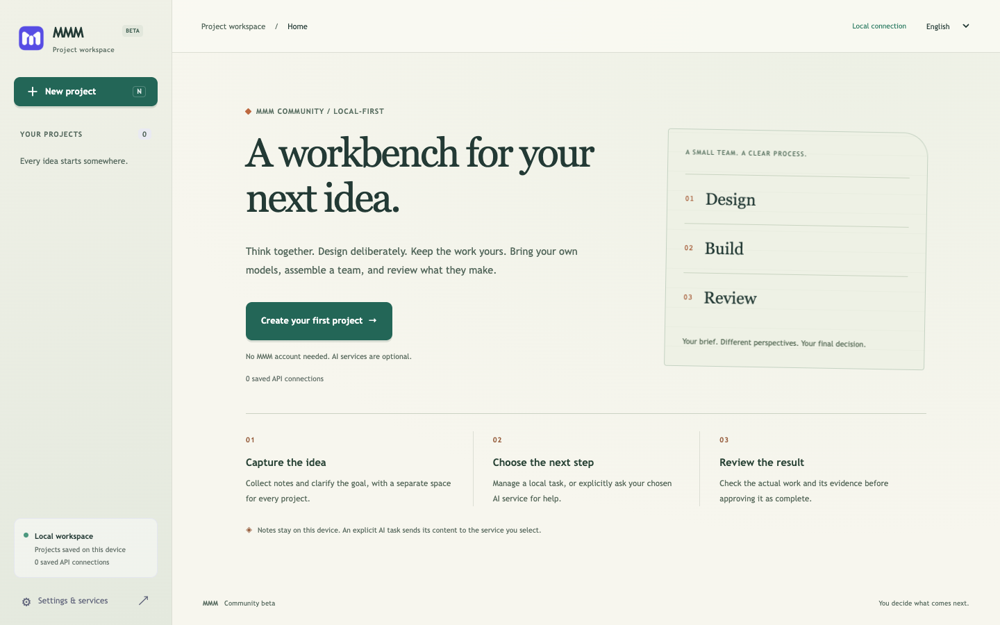
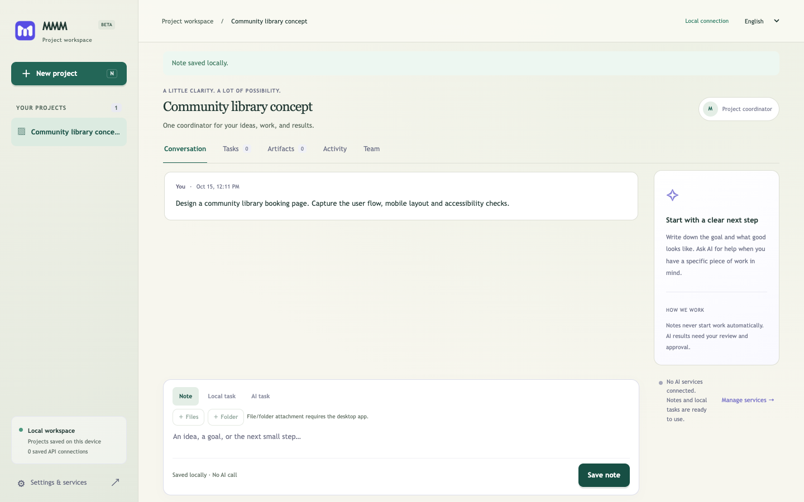
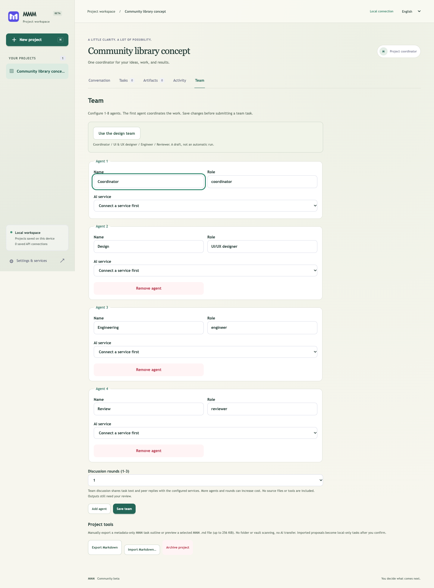

# MMM Community

一个以本地数据为中心的工作台，帮助你组织多模型讨论、设计工作与人工验收。

[English](README.md) · [繁體中文](README.zh-Hant.md) · **简体中文**

**社区测试版 | MIT | Node.js 24+**

**目前支持 macOS 和 Linux 的浏览器模式，暂不支持原生 Windows。**初步托管测试发现 Windows 的文件权限、已打开文件及数据迁移行为有差异，请勿依赖此测试版保存 Windows 数据。可选的原生 CLI 桥接只支持 macOS；Linux 的浏览器与 API 功能单独运行。

一起思考，审慎设计，工作由你掌握。

这份独立源码版本基于较早期的 MMM 公开应用，并不是将私人应用或其 Git 历史公开。它**不包含 Antigravity 集成**，也无需 MMM 账号；原有私人仓库没有因此公开。

社区项目：[jacbus1/mmm-community](https://github.com/jacbus1/mmm-community)。



## 系统截图

图片来自此社区版的真实界面，使用一次性的本地示例项目；没有连接 AI 服务，也没有运行 AI 任务。

**项目工作区：** 保存在本地的合成社区图书馆笔记。



**设计团队草稿：** 四个角色，尚未设置 AI 服务。



团队图片展示的是**尚未保存或执行的草稿**，不是代理完成工作的记录。图片没有个人账号、凭证或本地 session 网址。

## 快速开始

安装 Node.js 24 或更新版本，然后克隆项目：

```sh
git clone https://github.com/jacbus1/mmm-community.git
cd mmm-community
node --version
npm start
```

也可以从 [Releases](https://github.com/jacbus1/mmm-community/releases) 下载源码归档，解压后在目录内运行 `npm start`。

打开终端输出的**完整本地网址**，包括 session 片段。该片段是本地访问凭证，请勿分享或放入截图。服务器会选择可用的 loopback 端口；按 `Ctrl+C` 停止。创建本地工作无需 npm 包依赖或 API Key。

1. 创建项目，保存笔记或本地任务。
2. 如需 AI，在“设置与服务”中填写供应商、模型 ID 和密钥。
3. 在项目的“团队”页选择“使用设计团队”。
4. 为每个角色选择已配置的服务并保存。各角色可以复用同一个模型；多个供应商不是必需的。
5. 在“AI 任务”中选择团队讨论，并明确同意分享内容。
6. 检查成果并填写验收证据，再决定是否批准完成。

供应商请求可能收费。保存服务或团队配置不会开始工作；可选的连接测试会在你明确确认后发送少量请求。请使用自己供应商账号当前可用的模型 ID。

## 现有功能与限制

| 功能 | 源码浏览器版本 |
| --- | --- |
| 本地项目、笔记、任务、成果及验收证据 | 可用，无需 AI |
| 归档及恢复项目 | 可用 |
| JSON 导入及 Markdown 任务交换 | 可用；Markdown 不是完整备份 |
| 供应商 API 及 loopback 兼容的本地模型 | 需要明确同意 |
| 多模型讨论 | 1–8 位成员、1–3 轮、协调者汇总 |
| 设计团队预设角色 | 协调者、UI/UX 设计师、工程师、审核者 |
| 英文、繁体及简体中文界面 | 可用 |
| 浏览器模式的密钥 | 仅保存在内存中；服务器重启后需要重新输入 |
| 文件／文件夹、系统加密密钥、手动启动 CLI | 可选 Electron 桥接，不属于浏览器模式 |
| 自主编程、浏览器或 CLI 代理 | 尚未实现 |
| 云端托管、多人共用 | 不支持 |
| 已签名桌面安装包 | 未提供 |

设计团队预设值只是团队配置，不是 Figma 连接器或自动网站构建器。代理进行文本讨论，不会编辑文件或运行 shell 命令。Gateway 模型身份受到 `provider-policy.cjs` 允许列表限制，任意模型 ID 可能被拒绝。本项目不包含供应商套餐、额度或模型权重。

## 隐私与存储

服务绑定 `127.0.0.1`，每次启动都会验证 session，并检查请求来源。不要通过公开代理或隧道对外开放。MMM 不收集遥测，也不会自动导入个人账号数据。

| 平台 | 独立的 Community 数据目录 |
| --- | --- |
| macOS | `~/Library/Application Support/MMM-Community` |
| Linux | `$XDG_DATA_HOME/MMM-Community` 或 `~/.local/share/MMM-Community` |
| Windows（不支持） | 预留：`%LOCALAPPDATA%\MMM-Community` |

项目数据在磁盘上未加密，请使用操作系统磁盘加密。浏览器模式的供应商密钥只存在服务器内存中。明确提交的 AI 任务会将选定文本发送给指定供应商；团队讨论会向参与的供应商分享任务简报及先前回复。此测试版仅接受公开、非敏感输入；内容检测只是尽力而为，并非保证。请勿在提示中放入秘密。

备份时先停止程序，再将完整数据目录复制到自己的安全备份位置。Markdown 交换只包含任务元数据，不能代替完整备份。切勿将运行数据或密钥提交到 Git。

## 开发

```sh
npm test
npm run release:source
```

测试使用临时数据和模拟供应商，不会产生付费调用。源码打包使用明确的文件清单、运行内容扫描、固定 logo 哈希和 SHA-256 清单；需要系统 `tar`，并在 `dist/` 中生成 `.tar.gz` 和校验文件。归档包含测试与文档，不包含 Git 历史、凭证或运行数据。`package.json` 的 `private: true` 防止意外发布到 npm，不限制 MIT 源码再分发。

可选 Electron 桥接供贡献者使用，但这里没有安装或打包 Electron。桌面构建、签名与原生端到端验证仍是独立的发布工作。

参阅[设计](docs/DESIGN.md)、[架构](docs/ARCHITECTURE.md)、[路线图](docs/ROADMAP.md)、[贡献指南](CONTRIBUTING.md)和[安全策略](SECURITY.md)。这些深入文档目前以英文撰写。

## 许可

[MIT](LICENSE.txt)。供应商服务、模型权重、外部 CLI 和 Electron 有各自的许可与条款，不随本项目发布。
